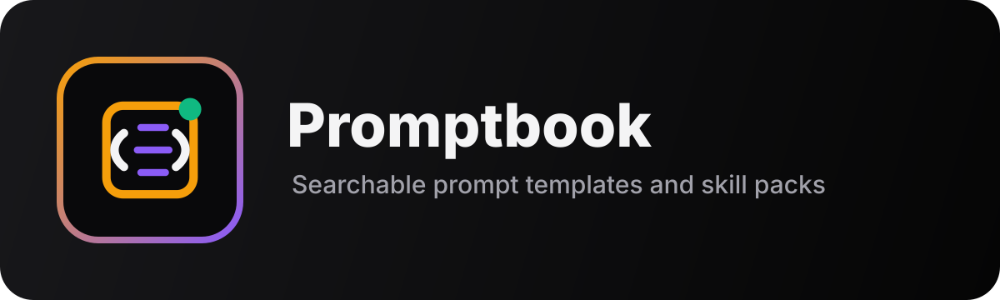

<a id="readme-top"></a>

<p align="center">
  <a href="https://promptbook-demo.ai-automation-tools.dev">
    
  </a>
</p>

<p align="center">
  <em><strong>Promptbook</strong> (formerly My Prompt Library) is a prompt library you clone and run on your own machine:<br>a curated public library to browse, and your own prompts as markdown files you own.</em>
</p>

<p align="center">
  <a href="docs/README.md"><strong>Explore the docs »</strong></a>
</p>

<p align="center">
  <a href="https://promptbook-demo.ai-automation-tools.dev">Browse the public library online (read-only)</a>
  ·
  <a href="https://github.com/ai-automation-tools/promptbook/issues">Report Bug</a>
  ·
  <a href="https://github.com/ai-automation-tools/promptbook/issues">Request Feature</a>
</p>

<p align="center">
  <a href="https://promptbook-demo.ai-automation-tools.dev"></a>
  
  <a href="docs/ROADMAP.md"></a>
</p>

<p align="center">
  
  
  
  
  
</p>

---

## Features

📚 **Two Libraries**
- **Public Library** - Thousands of curated prompts, agents, skills, guides and system prompts, in `site/library/`
- **My Library** - Your own prompts, one markdown file each, in a folder on your disk

📝 **Your Prompts Are Files**
- Create, edit and delete prompts in the app, or in any text editor
- Copy any public prompt into My Library with one click
- Tags, sections and categories live in each file's frontmatter
- Point `MY_LIBRARY_DIR` at a synced or git folder and your library is backed up

📦 **Skill Packs**
- Bundles of Agent Skills, one per skills folder plus hand-picked themes, added to or removed from My Library in one step
- Download any skill or pack as a ZIP

🔌 **MCP Servers**
- One card per Model Context Protocol server: maintainer, licence, auth, and install lines for Claude Code and any `mcpServers` client
- Install lines read from each server's own README, re-checked monthly

🤖 **Use It From An Agent**
- A built-in MCP server: Claude Code, Codex, Cursor or any MCP client can search the library, read any item, pull a skill with its files, and save to My Library
- Featured prompts and your own show up as slash commands

🎨 **Modern UI**
- Responsive design (mobile, tablet, desktop)
- The org house style shared with [ai-automation-tools.dev](https://ai-automation-tools.dev): sections in the top bar, a Light | Dark switch, and a Settings dialog with four colour palettes (sky, violet, emerald, ember), all remembered per browser; per-section accent colours
- ⌘K command palette across every prompt, section and action
- Fuzzy search with Fuse.js
- Title-prioritized search ranking (title starts-with/contains first)

🔒 **Nothing To Sign Up For**
- No accounts, no database, no API keys, no `.env` required
- The server listens on `127.0.0.1` only
- The [online demo](https://promptbook-demo.ai-automation-tools.dev) is the same app in read-only mode

---

## Quick Start

The app lives in `site/`. Run every `npm` command from there: the repo root has no `package.json`.

```bash
git clone https://github.com/ai-automation-tools/promptbook.git
cd promptbook/site
npm install
npm run dev        # or: npm start (build once, then serve)
```

Open http://localhost:3010. Your prompts are saved to `site/my-library/` (gitignored).

### Optional settings

Copy `site/.env.example` to `site/.env` to change a default:

| Variable | Default | What it does |
|:---|:---|:---|
| `MY_LIBRARY_DIR` | `my-library` | Where My Library is kept. Relative to `site/`, or absolute. |
| `HOST` | `127.0.0.1` | Address to listen on. There are no accounts, so read [this](docs/setup/SETUP.md#exposing-it-beyond-localhost) before opening it up. |
| `READ_ONLY` | `false` | `true` serves the Public Library only (My Library is neither listed nor served) and refuses every write. |
| `ALLOWED_HOSTS` | (none) | Extra hostnames the server answers to, comma-separated, for a proxy such as `tailscale serve`. Any other name gets `403`, which blocks DNS rebinding. See [this](docs/setup/SETUP.md#over-tailscale). |

### Checks

```bash
npm run lint             # tsc --noEmit
npm run test:routes      # the API route table is intact
npm run test:my-library  # the My Library file store
npm run test:read-only   # read-only mode hides My Library
npm run test:mcp         # the MCP server, end to end over stdio
npm run build:index      # rebuild api/prompt-index.json after editing library/

node scripts/upstream.test.mjs           # provenance frontmatter (run from the repo root)
node scripts/skill-frontmatter.test.mjs  # Agent Skills spec compliance
```

CI runs all of these on every PR and fails if the committed prompt index is stale.

---

## Use It From An Agent

The repo ships an MCP server (`site/mcp/server.ts`) that reads the same folders as the app.
Nothing else needs to be running. After `npm install` in `site/`, add it to your agent:

```bash
# Claude Code (use the absolute path to your clone)
claude mcp add promptbook -- npm --prefix /path/to/promptbook/site run --silent mcp
```

Any other MCP client, as an `mcpServers` entry:

```json
{
  "mcpServers": {
    "promptbook": {
      "command": "npm",
      "args": ["--prefix", "/path/to/promptbook/site", "run", "--silent", "mcp"]
    }
  }
}
```

| Tool | Does |
|:---|:---|
| `search_library` | Search every section and My Library by words, section, category or tags |
| `get_item` | The full markdown of one item |
| `list_sections`, `list_categories` | What is in the library, with counts |
| `get_skill`, `get_skill_file` | A skill's `SKILL.md` and its support files |
| `list_skill_packs`, `get_skill_pack` | The Skill Packs and the skills in each |
| `save_to_my_library`, `update_my_prompt`, `update_from_public`, `delete_my_prompt` | Write to My Library (not offered when `READ_ONLY=true`) |

It also offers MCP prompts: `library_prompt` takes any library id, and every featured prompt
and every My Library prompt is listed by name, so clients show them as slash commands. It
honours `MY_LIBRARY_DIR` and `READ_ONLY` from `site/.env`. Setup for each client:
[docs/mcp-server.md](docs/mcp-server.md). How it works: [docs/features/MCP-SERVER.md](docs/features/MCP-SERVER.md).

---

## Documentation

📚 **[Complete Documentation](docs/)** - Full documentation index

### Quick Links

**Getting Started**
- [Setup Guide](docs/setup/SETUP.md) - Run it locally, configure My Library
- [Hosted Demo](docs/setup/DEPLOYMENT.md) - How the read-only demo is built on Vercel
- [Architecture](docs/ARCHITECTURE.md) - System design
- [Diagrams](docs/diagrams/README.md) - The library data flow shown on the [homepage](https://promptbook.ai-automation-tools.dev/#diagram), interactive and linked to the code

**Creating Content**
- [Contributing Guide](docs/CONTRIBUTING.md) - How to add content
- [Templates](docs/templates/) - Starter templates for all content types
- [Roadmap](docs/ROADMAP.md) - What's next
- [Changelog](docs/CHANGELOG.md) - Shipped work

**Features**
- [API Reference](docs/features/API.md) - REST API endpoints
- [Library Modes](docs/features/LIBRARY-MODE-IMPLEMENTATION.md) - Public vs My Library
- [Featured Prompts](docs/features/FEATURED-PROMPTS.md) - Highlighting top prompts
- [MCP Server Setup](docs/mcp-server.md) - Install the MCP server in Claude Code or any MCP client
- [MCP Server](docs/features/MCP-SERVER.md) - The library as an MCP server: tools, prompts, install and how it stays current

**Development**
- [Debug Guide](docs/development/DEBUG_UI.md) - Troubleshooting

---

## Technology Stack

**Frontend:**
- React + TypeScript
- Vite (build tool)
- Tailwind CSS
- Lucide React (icons)
- Fuse.js (search)

**Backend:**
- Express + TypeScript, run with `tsx`
- gray-matter (frontmatter for both libraries)
- Markdown files on disk, no database

**Hosting:**
- Your machine (the app)
- Vercel (the read-only demo)
- GitHub Pages (the [homepage](https://promptbook.ai-automation-tools.dev))

---

## Project Structure

```
promptbook/
├── site/                     # The app (run npm here; Vercel Root Directory = site)
│   ├── api/                  # API handlers (one Express app, also run by Vercel)
│   ├── lib/                  # library.ts (shared reader), my-library.ts (file store), safe-path.ts
│   ├── mcp/                  # The MCP server (npm run mcp)
│   ├── src/                  # React application
│   │   ├── App.tsx           # Main React component
│   │   ├── components/       # UI components
│   │   ├── lib/mode.ts       # Read-only flag for the UI
│   │   └── main.tsx          # Entry point
│   ├── library/              # Public prompt templates (numbered)
│   │   ├── 1_Guides/
│   │   ├── 2_Agents/
│   │   ├── 3_Skills/
│   │   ├── 4_Prompts/
│   │   ├── 5_System_Prompts/
│   │   └── 6_MCP_Servers/
│   ├── my-library/           # Your prompts (gitignored, created on first save)
│   ├── scripts/              # build-prompt-index.js, the route, My Library and MCP tests
│   └── server.ts             # Local server around the same app api/ exports (port 3010)
├── homepage/                 # Static project homepage (GitHub Pages)
├── .github/workflows/ci.yml  # lint + route, store and MCP tests + provenance checks + index freshness
├── .gitattributes            # LF everywhere, in the repo and the working tree
├── LICENSE, NOTICE           # Apache 2.0 for the app; vendored content keeps its own
├── SECURITY.md, CODE_OF_CONDUCT.md, CONTRIBUTING.md
├── docs/                     # Project documentation (DISCOVERY.md is the repo-intake ledger)
├── scripts/                  # Library tooling: provenance, skills sync, skill packs, discovery, link check
└── README.md
```

---

## My Library Files

Each prompt is one file, named `<slug-of-title>-<6 hex>.md`:

```markdown
---
title: Code review checklist
section: 4_Prompts
category: Coding
tags:
  - review
created: '2026-10-21T14:02:11.000Z'
updated: '2026-10-21T14:02:11.000Z'
---
Review this diff for...
```

Edit them by hand if you like; the app re-reads the folder on every load. Skill packs you add
are ordinary files tagged `skill-pack:<packId>`. Details in the [Setup Guide](docs/setup/SETUP.md#my-library-on-disk).

---

## API Endpoints

### Prompts
- `GET /api/prompts?library=public|my` - List prompts (add `&lightweight=true` for metadata only —
  no body text at all for the public library)
- `POST /api/prompts/previews` - Card blurbs for a batch of ids (`{ ids: string[] }`, 200 max)
- `GET /api/prompts/:id` - One prompt with its full body
- `POST /api/prompts` - Create a My Library prompt
- `PUT /api/prompts/:id` - Update a My Library prompt
- `DELETE /api/prompts/:id` - Delete a My Library prompt
- `POST /api/prompts/:path/copy-to-my-prompts` - Copy a public prompt to My Library

### Skill Packs
- `GET /api/skill-packs?library=public|my` - List packs by mode
- `GET /api/skill-packs/:packId` - Pack details
- `POST /api/skill-packs/:packId/add-to-library` - Add pack to My Library (confirm)
- `DELETE /api/skill-packs/:packId/remove-from-library` - Remove pack from My Library (confirm)
- `GET /api/skill-packs/:packId/download` - Download pack ZIP

### Skills
- `GET /api/skills/download/:skillPath` - Download a skill directory as a ZIP

Every route that writes returns `403` in read-only mode. See [docs/features/API.md](docs/features/API.md) for detailed documentation.

---

## Contributing

This is a personal project, but suggestions and feedback are welcome!

1. Fork the repository
2. Create a feature branch (`git checkout -b feature/amazing-feature`)
3. Commit changes (`git commit -m 'Add amazing feature'`)
4. Push to branch (`git push origin feature/amazing-feature`)
5. Open a Pull Request

---

## License

The application code is licensed under the [Apache License 2.0](LICENSE).

Content under `site/library/` is a mix of original work and vendored third-party skills and prompts. Vendored skills keep their own `LICENSE` file and an `upstream:` frontmatter block naming the source; see [NOTICE](NOTICE) and [docs/UPSTREAMS.md](docs/UPSTREAMS.md). Those files are governed by their own licenses, not by this repository's.

---

## Support

- **Issues:** [GitHub Issues](https://github.com/ai-automation-tools/promptbook/issues)
- **Documentation:** [docs/](docs/)
- **Email:** mikeschecht@gmail.com

---

**Built with ❤️ by Michael Schecht**
