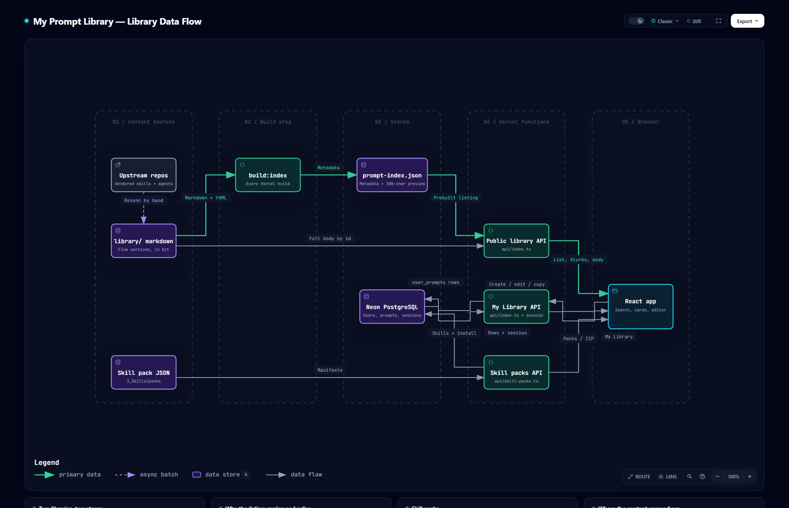

<h1 align="center">🧭 Diagrams</h1>

<p align="center">
  <em>Where My Prompt Library's content and user data come from and where they go, drawn from the code and checked against it.</em>
</p>

<p align="center">
  
  
  <a href="../README.md"></a>
</p>

---

## 📚 Library data flow

[](library-data-flow.html)

How a prompt reaches the browser: the Public Library is markdown in `site/library/`, which
`build:index` walks on every build into `prompt-index.json`. The public library API serves that
index as a metadata-only listing, card blurbs from its previews, and a prompt's full body from the
file when it is opened. My Library is separate: creates, edits and copies go through the
session-checked API into Neon PostgreSQL, and the skill packs function copies a pack's skills into
the same table and records the install. Upstream skill repos feed the library only when someone
runs the resync script by hand. Below the map, four cards cover the two libraries, why the listing
carries no bodies, skill packs, and where the content comes from.

**See it on the [homepage](https://my-prompt-library.ai-automation-tools.dev/#diagram)**, or open the interactive version: [`library-data-flow.html`](library-data-flow.html) in a browser
from a clone, or [render it from GitHub](https://raw.githack.com/ai-automation-tools/my-prompt-library/main/docs/diagrams/library-data-flow.html).
Each node links to the exact lines it describes at the pinned commit, and the viewer adds route
tracing, search, light/dark, and SVG/PNG export.

## 📂 Files

| File | What it is | Edit it? |
|:---|:---|:---|
| [`library-data-flow.json`](library-data-flow.json) | The source: stages, nodes, flows, cards, and the code each node cites | **Yes, this is the only file you edit** |
| `library-data-flow.html` · `.png` | Generated: the interactive diagram, which the homepage embeds live, and a static PNG snapshot | Never; rebuild |
| `homepage/diagram/library-data-flow.html` · `.png` | Copies the build writes for the homepage, which publishes only `homepage/`. `--check` flags a copy that differs | Never; rebuild |
| `library-data-flow.delivery.json` · `.sources.lock.json` | Build receipt, and the git blob of every cited file at the pinned commit | Never; rebuild |
| [`../../scripts/build-diagram.mjs`](../../scripts/build-diagram.mjs) | Builds the diagram and checks it for drift | Only to change how it builds or checks |

## 🔁 Keeping it current

Every node cites code by path and line range, pinned to the commit in `meta.repository.revision`.
The cited files are `site/api/index.ts`, `site/api/skill-packs.ts`, `site/db/postgres.ts`,
`site/scripts/build-prompt-index.js`, `site/package.json`, `site/src/App.tsx`, the
`usePromptPreviews` and `usePromptContent` hooks, `scripts/resync-upstream.mjs` and
`.github/workflows/upstream-drift.yml`. When one changes, the diagram may describe logic that moved
or no longer exists, so it counts as stale until someone has re-read that code.

| When | What catches it |
|:---|:---|
| **Every push and PR** | CI's *Diagram drift* step runs `--hook` and turns each finding into a warning annotation. It never fails the build |
| **Any time** | `node scripts/build-diagram.mjs --check` exits 1 and names the stale files |
| **Weekly** | The repo owner's doc drift check runs `--check` on the local clone, and the org upkeep job rebuilds a stale diagram by PR |

To bring it up to date:

1. Commit the code change first. Evidence is pinned to committed bytes, never to working-tree edits.
2. Re-read each changed file the check named. In `library-data-flow.json`, fix the line ranges in
   `sources` (at most three per node), and any label, sublabel, flow or card the change made
   untrue. A new store or API surface gets a node in the stage it belongs to; a removed one goes.
   Keep the existing ids.
3. Rebuild, re-pinning to the commit you just read:

   ```bash
   node scripts/build-diagram.mjs --pin-head
   ```

4. Commit the JSON, the generated files and the `homepage/diagram/` copies together, with a [CHANGELOG](../CHANGELOG.md) line.

Building needs Node 18+, Chrome, and the [Archify](https://github.com/tt-a1i/archify) skill
(default path `~/.claude/skills/archify/bin/archify.mjs`; pass `--archify <path>` to point
elsewhere). The check needs only git. A failed build exits 1 and leaves the last good HTML and
PNG in place; the reason is in `docs/diagrams/.build/library-data-flow.finalize-summary.json`.

---

<p align="center">
  <sub>← <a href="../README.md">Documentation home</a> · <a href="../../README.md">My Prompt Library</a></sub>
</p>
